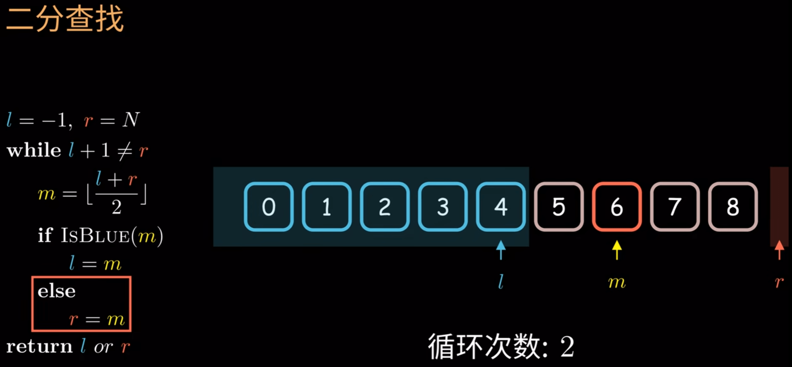

# OI 笔记

<!-- more -->

## ST 表

`data[k][i]` 表示以 $a_i$ 为左端点、长度为 $2^k$ 的一段区间信息，右端点是 $a_{i+2^k-1}$。其中 $k\ge 0$，$i\ge 1$。

把较小的一维放在前面，遍历时应按 **先第一维，再第二维** 的顺序访问，即：

```cpp
for (int k = 0; k <= K; k++)
    for (int i = 1; i + (1 << k) - 1 <= n; i++)
        ...
```

这样在 C/C++ 行优先存储下，内层 `i` 连续访问，缓存友好。

第一维大小应为 $\lfloor\log_2 n\rfloor+1$，下标范围是 $0\sim\lfloor\log_2 n\rfloor$。例如序列总长度 $n=10^5$，则第一维大小应为 $\bold{17}$，最大可访问下标是 `data[16][...]`，因为 $2^{16}=65536$ 大于序列总长度的一半，所以查询整个序列时，用两个长度为 $2^{16}$ 的区间即可覆盖整个序列。

```cpp
constexpr ll N = 1e5 + 5;
constexpr ll LOGN = 18;

struct ST {
    ll n;
    ll st[LOGN][N], lg[N];

    // 构建 ST 表
    void build(ll *a, ll param) {
        n = param;
        lg[1] = 0;
        for (ll i = 2; i <= n; i++) lg[i] = lg[i >> 1] + 1;
        for (ll i = 1; i <= n; i++) st[0][i] = a[i];
        for (ll k = 1; k <= lg[n]; k++)
            for (ll i = 1; i + (1 << k) - 1 <= n; i++)
                st[k][i] = max(st[k - 1][i], st[k - 1][i + (1 << (k - 1))]);
    }

    // 查询区间 [l, r] 的最大值
    ll query(ll l, ll r) const {
        ll k = lg[r - l + 1];
        return max(st[k][l], st[k][r - (1 << k) + 1]);
    }
};
```

## 归并排序

`begin >= end` 表示空区间（无效区间）。

注意 `while` 的条件是 `&&`。

空间复杂度 $O(n)$。

```cpp
void merge_sort(ll* a, ll begin, ll end) {
    if (begin >= end) return;

    ll mid = begin + (end - begin) / 2;

    merge_sort(a, begin, mid);
    merge_sort(a, mid + 1, end);

    ll i = begin;
    ll left = begin, right = mid + 1;

    while (left <= mid && right <= end) {
        if (a[left] <= a[right]) {
            helper[i++] = a[left++];
        } else {
            helper[i++] = a[right++];
        }
    }

    while (left <= mid) helper[i++] = a[left++];
    while (right <= end) helper[i++] = a[right++];

    memcpy(a + begin, helper + begin, sizeof(ll) * (end - begin + 1));
}
```

## 快速排序

`begin >= end` 表示空区间（无效区间）。

随机选择基准元素 `pivot`，通过一次遍历将原数组分为三个区：**小于** `pivot` 的，**等于** `pivot` 的，**大于** `pivot` 的，然后在小于和大于的区间内递归执行。

此处采用非常规写法。在遍历过程中，`[begin, p1]` 表示 **小于** `pivot` 的区间，`[p1 + 1, p2]` 表示 **等于** `pivot` 的区间，`[p2 + 1, i - 1]` 表示 **大于** `pivot` 的区间。

初始时三个区间都为空，应将 `p1`、`p2` 均设为 `begin - 1`。

空间复杂度 $O(1)$。

```cpp
void quick_sort(ll* a, ll begin, ll end) {
    if (begin >= end) return;

    ll pivot = a[range_rand(begin, end)];
    ll p1 = begin - 1, p2 = begin - 1;

    for (ll i = begin; i <= end; i++) {
        if (a[i] < pivot) {
            swap(a + i, a + p2 + 1);
            swap(a + p2 + 1, a + p1 + 1);
            p1++, p2++;
        } else if (a[i] == pivot) {
            swap(a + i, a + p2 + 1);
            p2++;
        }
    }

    quick_sort(a, begin, p1);
    quick_sort(a, p2 + 1, end);
}
```

## 基数排序

低位优先（LSD），先按照低 16 位排序，再按照高 16 位排序。

取低 16 位：`x & 0xffffll`；取高 16 位：`x >> 16 & 0xffffll`。

**涉及移位操作的整数字面量建议带上 `ll` 或 `ull` 后缀。**

内部排序采用计数排序，用 `cnt` 数组记录出现的次数，累加前缀和。写入时从后往前，次数前缀和先自减，然后作为写入的数组下标。

只能用于非负整数的排序，且元素的最大值不超过 $2^{32}-1$。

空间复杂度 $O(n+V)$，$V$ 为 16 位的值域大小。

```cpp
void radix_sort(ll* a, ll begin, ll end) {
    for (ll i = begin; i <= end; i++) cnt[a[i] & 0xffffll]++;
    for (ll i = 1; i <= 0xffffll; i++) cnt[i] += cnt[i - 1];

    // 低 16 位排序的结果写入 b 数组
    for (ll i = end; i >= begin; i--) {
        cnt[a[i] & 0xffffll]--;
        b[begin + cnt[a[i] & 0xffffll]] = a[i];
    }

    memset(cnt, 0, sizeof(cnt));

    for (ll i = begin; i <= end; i++) cnt[b[i] >> 16 & 0xffffll]++;
    for (ll i = 1; i <= 0xffffll; i++) cnt[i] += cnt[i - 1];

    // b 数组按高 16 位排序后再写入原数组
    for (ll i = end; i >= begin; i--) {
        cnt[b[i] >> 16 & 0xffffll]--;
        a[begin + cnt[b[i] >> 16 & 0xffffll]] = b[i];
    }
}
```

## 滚动锦标赛排序

```cpp
int winner(int a, int b, vector<int>& nums) {
    if (a == -1) return b;
    if (b == -1) return a;
    if (nums[a] < nums[b]) return a;
    return b;
}

void sort(vector<int>& nums) {
    vector<int> tree, ans;
    tree.reserve(nums.size() * 2 - 1);
    ans.reserve(nums.size());

    for (size_t i = 0; i < nums.size(); i++) tree.push_back(i);

    for (size_t i = 0; i < tree.size() - 1; i += 2)
        tree.push_back(winner(tree[i], tree[i + 1], nums));

    for (size_t i = 0; i < nums.size(); i++) {
        size_t root = tree.back();
        ans.push_back(nums[root]);
        tree[root] = -1;
        while (root < tree.size() - 1) {
            size_t parent = root / 2 + nums.size();
            tree[parent] = winner(tree[root], tree[root ^ 1], nums);
            root = parent;
        }
    }

    nums.assign(ans.begin(), ans.end());
}
```

## 矩阵

```cpp
struct mat {
  ll row, col, data[105][105];  // row 行 col 列
  mat(ll i, ll j) : row(i), col(j) {
    memset(data, 0, sizeof(data));
  }
  ll* operator[](ll i) {
    return data[i];
  }
};

mat operator+(mat a, mat b) {
  for (ll i = 1; i <= a.row; i++) {
    for (ll j = 1; j <= a.col; j++)
      a[i][j] += b[i][j];
  }
  return a;
}

mat operator*(mat a, mat b) {
  mat c(a.row, b.col);
  for (ll i = 1; i <= a.row; i++) {
    for (ll j = 1; j <= b.col; j++) {
      c[i][j] = 0;
      for (ll k = 1; k <= a.col; k++)
        c[i][j] += a[i][k] * b[k][j];
    }
  }
  return c;
}

mat qpow(mat a, ll b) {
  mat c(a.row, a.col);
  for (ll i = 1; i <= a.row; i++)
    c[i][i] = 1;
  for (; b; b >>= 1) {
    if (b & 1) c = c * a;
    a = a * a;
  }
  return c;
}

void print(mat a) {
  for (ll i = 1; i <= a.row; i++) {
    for (ll j = 1; j <= a.col; j++)
      cout << a[i][j] << ' ';
    cout << endl;
  }
}
```

## 二分



## Miller-Rabin 素性测试

```cpp
bool is_prime(ll n) {
  if (n == 0 || n == 1) return 0;
  if (n == 2 || n == 3) return 1;
  if (n % 2 == 0) return 0;  // 除了 2 的偶数
  ll u = n - 1, t = 0;
  while (n % 2 == 0) n >>= 1, t++;
  ll primes[] = {2, 3, 5, 7, 11, 13, 17, 19, 23, 29, 31, 37}; // 前 12 个素数
  for (ll prime : primes) {
    ll v = qpow(prime, u, n);
    if (v == 0 || v == 1 || v == n - 1) continue;
    for (ll i = 1; i <= t; i++) {
      v = v * v % n;
      if (v == 1) return 0;
      if (v == n - 1 && i < t) {
        v = 1;
        break;
      }
    }
    if (v != 1) return 0;
  }
  return 1;
}
```

## 字符串双模哈希

[P11276 第一首歌](https://www.luogu.com.cn/problem/P11276)

- 第一组：Base $137$，Mod $10^9+7$
- 第二组：Base $139$，Mod $10^9+9$

```cpp
struct Hash {
  ll base, mod, p[N], hs[N];
  Hash(ll b, ll n, ll m) {
    base = b, mod = m, p[0] = 1;
    for (ll i = 1; i <= n; i++) p[i] = p[i - 1] * base % mod;
  }
  void make(string s) {
    ll n = s.size();
    s = '0' + s, hs[0] = 0;
    for (ll i = 1; i <= n; i++) hs[i] = (hs[i - 1] * base % mod + s[i]) % mod;
  }
  ll get(ll l, ll r) {
    return (hs[r] + mod - hs[l - 1] * p[r - l + 1] % mod) % mod;
  }
} hs1(137, 1e6, 1e9 + 7), hs2(139, 1e6, 1e9 + 9);
```

## 浮点数二分

使用常规的 `while (l + eps < r)` 可能会造成死循环，此时可采取如下的写法

```cpp
for (int i = 1; i <= 1000; i++) {
    mid = (l + r) / 2.0;
    check(mid) ? l = mid : r = mid;
}
```

手动设定二分次数，不会出现死循环，最终答案区间长度缩小到原来的 $\frac{1}{2^{1000}}$。

## 生成随机数

生成 $[n,m]$ 内的随机整数。

```cpp
random_device rd;
mt19937 gen(rd());

ll range_random(ll n, ll m) { // 闭区间 [n, m]
    uniform_int_distribution<ll> dist(n, m);
    return dist(gen);
}
```

## LCA

```cpp
const ll N = 5e5 + 5;

struct Edge {
  ll f, t, nxt;
} edge[N * 2];

ll cnt, head[N];
void add_edge(ll f, ll t) {
  cnt++;
  edge[cnt] = {f, t, head[f]};
  head[f] = cnt;
}

ll fa[N];
ll getf(ll x) {
  return x == fa[x] ? x : fa[x] = getf(fa[x]);
}

struct query {
  ll node, id;
  query(ll n, ll i) {node = n, id = i;}
};

ll n, m, s, ans[N];
vector<query> q[N];

bool vis[N];
void tarjan(ll u) {
  vis[u] = true;
  for (ll i = head[u]; i; i = edge[i].nxt) {
    ll v = edge[i].t;
    if (!vis[v]) {
      tarjan(v);
      fa[v] = u;
    }
  }
  for (auto i : q[u]) {
    ll node = i.node, id = i.id;
    if (vis[node]) ans[id] = getf(node);
  }
}

int main(void) {
  ios::sync_with_stdio(false);
  cin.tie(nullptr);
  cin >> n >> m >> s;
  for (ll i = 1; i <= n; i++) fa[i] = i;
  for (ll i = 1; i < n; i++) {
    ll x, y;
    cin >> x >> y;
    add_edge(x, y);
    add_edge(y, x);
  }
  for (ll i = 1; i <= m; i++) {
    ll a, b;
    cin >> a >> b;
    q[a].push_back(query(b, i));
    q[b].push_back(query(a, i));
  }
  tarjan(s);
  for (ll i = 1; i <= m; i++) cout << ans[i] << endl;
  return 0;
}
```

## 欧拉路径

- 欧拉回路：通过图中每条边恰好一次的回路。

- 欧拉通路：通过图中每条边恰好一次的通路。

- 欧拉图：具有欧拉回路的图。

- 半欧拉图：具有欧拉通路但不具有欧拉回路的图。

无向图是欧拉图当且仅当：非零度顶点是连通的；顶点的度数都是偶数。

无向图是半欧拉图当且仅当：非零度顶点是连通的；恰有 2 个奇度顶点。

有向图是欧拉图当且仅当：非零度顶点是强连通的；每个顶点的入度和出度相等。

有向图是半欧拉图当且仅当：非零度顶点是弱连通的；恰有一个顶点的出度与入度之差为 1；恰有一个顶点的入度与出度之差为 1；其他顶点的入度和出度相等。

```cpp
void dfs(ll u) {
  for (ll &i = h[u]; i; i = e[i].nxt) {
    if (e[i].v) {
      e[i].v = 0;
      dfs(e[i].t);
    }
    if (!i) break;
  }
  st[++tp] = u;
}
```

## 判断二分图

```cpp
const ll N = 1e5 + 5, M = 2e5 + 5;

struct Edge {
  ll v, nxt;
} edge[M];

ll cnt;
void add(ll f, ll t) {
  cnt++;
  edge[cnt] = {t, head[f]};
  head[f] = cnt;
}

ll color[N];
bool dfs(ll u, ll c) {
  color[u] = c;
  for (ll i = head[u]; i; i = edge[i].nxt) {
    ll v = edge[i].v;
    if (!color[v]) { // 如果 color 为空 (没有染色)
      if (dfs(v, 3 - c)) return true; // 有奇环
    } else {
      if (color[v] == c) return true; // 有奇环
    }
  }
  return false;
}

int main(void) {
  cin >> n >> m;
  for (ll i = 1; i <= m; i++) {
    ll a, b;
    cin >> a >> b;
    add(a, b);
    add(b, a);
  }
  bool flag = false;
  for(ll i = 1; i <= n; i++) {
    if (!color[i]) {
      if (dfs(u, 1)) {
        flag = true;
        break;
      }
    }
  }
  if (flag) cout << "NO";
  else cout << "YES";
  return 0;
}
```

## 二分图最大匹配

```cpp
#include <bits/stdc++.h>
using namespace std;
typedef long long ll;
const ll N = 505, M = 50005;
ll n, m, e, ans;
ll head[N], cnt, match[N];
bool vis[N];
struct Edge {
  ll v, nxt;
} edge[M];
void add(ll f, ll t) {
  cnt++;
  edge[cnt] = {t, head[f]};
  head[f] = cnt;
}
bool dfs(ll u) {
  for (ll i = head[u]; i; i = edge[i].nxt) {
    ll v = edge[i].v;
    if (vis[v]) continue;
    vis[v] = 1;
    if (!match[v] || dfs(match[v])) {
      match[v] = u;
      return true;
    }
  }
  return false;
}
int main(void) {
  cin >> n >> m >> e;
  for (ll i = 1; i <= e; i++) {
    ll u, v;
    cin >> u >> v;
    add(u, v);
  }
  for (ll i = 1; i <= n; i++) {
    memset(vis, 0, sizeof(vis));
    if (dfs(i)) ans++;
  }
  cout << ans;
  return 0;
}
```

## priority_queue

priority_queue 默认是**大根堆**（堆顶为最大元素）。

**小根堆**请使用 greater：`priority_queue<ll, vector<ll>, greater<ll>> q;`

或重新定义比较函数：

```cpp
struct compare {
  bool operator()(int a, int b) { return a > b; } // 这里定义了小根堆
};
priority_queue<int, vector<int>, compare> q_min;
```

- `empty()`：检查队列是否为空。
- `size()`：返回队列中的元素数量。
- `top()`：返回队列顶部的元素（不删除它）。
- `push()`：向队列添加一个元素。
- `pop()`：移除队列顶部的元素。

## 取模和逆元

当 $p$ 为质数时，$\text{inv}(b) = b^{p-2} \bmod p$。

```cpp
(a + b) % mod = ((a % mod) + (b % mod)) % mod
(a * b) % mod = ((a % mod) * (b % mod)) % mod
(a - b) % mod = ((a % mod) - (b % mod) + mod) % mod
(a / b) % mod = ((a % mod) * (inv(b) % mod)) % mod
```

## 快速斐波那契

数学原理。$O(\log_2 n)$，常数略小于矩阵乘法。

```cpp
map<ll, ll> ff;
ll f(ll x) {
  if (x == 1 || x == 2) return 1;
  if (ff[x]) return ff[x];
  ll t = x >> 1, a, b;
  if (x & 1) {
    a = f(t), b = f(t + 1);
    return ff[x] = a * a + b * b;
  } else {
    a = f(t), b = f(t - 1);
    return ff[x] = ((b << 1) + a) * a;
  }
}
```

## 并查集

初始化时把 `fa[i]` 设为 `i`，表示每个元素自身构成单元集合。

`tot` 表示当前的集合个数。每当 `merge()` 两个不同集合的元素时，`tot` 减一。当 `tot` 为 1 时，所有元素连通。

`getf()` 使用路径压缩。

`merge()` 注意先求 `fx` 和 `fy`，再把 `fx` 挂到 `fy` 的名下。

可用于 Kruskal 算法求最小生成树，注意连边时仍然要判断两个节点是否在同一个集合中。

```cpp
struct DSU {
    ll n, tot;
    vector<ll> fa;

    DSU(ll param) {
        n = tot = param;
        fa.resize(n + 1);
        for (ll i = 1; i <= n; i++) fa[i] = i;
    }

    ll getf(ll x) {
        if (fa[x] == x) return x;
        return fa[x] = getf(fa[x]);
    }
    
    void merge(ll x, ll y) {
        ll fx = getf(x), fy = getf(y);
        if (fx == fy) return;
        fa[fx] = fy;
        tot--;
    }
};
```

## 快速幂

求 $a^b \bmod p$。

```cpp
ll qpow(ll a, ll b, ll p) {
  ll r = 1;
  while (b) {
    if (b & 1) r = r * a % p;
    a = a * a % p, b >>= 1;
  }
  return r;
}
```

## 树状数组

数组起始下标必须是 1，否则对于下标 0，0 ± lowbit(0) 都是 0，会造成死循环。

`add()` 的循环条件是 `i <= n`，这里 `n` 是序列中数的个数。

`get()` 的循环条件是 `i > 0`，原因见上。

```cpp
ll lowbit(ll x) { return x & -x; }

struct BIT {
    ll n;
    vector<ll> data;
    BIT(ll param) {
        n = param;
        data.resize(n + 1, 0);
    }
    void add(ll i, ll x) {
        for (; i <= n; i += lowbit(i)) data[i] += x;
    }
    ll get(ll i) {
        ll sum = 0;
        for (; i > 0; i -= lowbit(i)) sum += data[i];
        return sum;
    }
};
```

## 取整函数

```cpp
double floor(double num); // 向下取整
double  ceil(double num); // 向上取整
double round(double num); // 四舍五入
```

## 类型大全

```cpp
         short min = -32768
         short max =  32767
unsigned short max =  65535

         int min = -2147483648
         int max =  2147483647
unsigned int max =  4294967295

         long min = -9223372036854775808
         long max =  9223372036854775807
unsigned long max =  18446744073709551615

         long long min = -9223372036854775808
         long long max =  9223372036854775807
unsigned long long max =  18446744073709551615

  sizeof(char)    =  8
         char min = -128
         char max =  127
  signed char min = -128
  signed char max =  127
unsigned char max =  255
```

## 纯手写 48 位高精度

最高十进制 48 位，即最大可存储 $10^{48}-1$。

```cpp
constexpr ll E16 = 1e16;
struct ull {
  ll h, m, l;
  friend ull operator+(ull a, ll b) {
    a.m += (b + a.l) / E16;
    a.l = (b + a.l) % E16;
    return a;
  }
  friend ull operator+(ull a, ull b) {
    a.m += (b.l + a.l) / E16;
    a.l = (b.l + a.l) % E16;
    a.h += (b.m + a.m) / E16;
    a.m = (b.m + a.m) % E16;
    a.h = (b.h + a.h) % E16;
    return a;
  }
};
ull read(void) {
  string s;
  cin >> s;
  ll h = 0, m = 0, l = 0, n = s.size(), i = 0;
  if (n > 32 && n <= 48) while (i < n - 32) h = h * 10 + s[i++] - '0';
  if (n > 16 && n <= 48) while (i < n - 16) m = m * 10 + s[i++] - '0';
  if (n > 0 && n <= 48) while (i < n) l = l * 10 + s[i++] - '0';
  ull a = {h, m, l};
  return a;
}
void write(ull a) {
  if (a.h > 0) printf("%lld%016lld%016lld", a.h, a.m, a.l);
  else if (a.m > 0) printf("%lld%016lld", a.m, a.l);
  else if (a.l > 0) printf("%lld", a.l);
}
```

## 普通快读

```cpp
ll read(void) {
  ll n = 0;
  bool f = 1;
  char c = getchar();
  while (!isdigit(c)) {
    c == '-' && (f = 0);
    c = getchar();
  }
  while (isdigit(c)) {
    n = (n << 1) + (n << 3) + (c ^ 48);
    c = getchar();
  }
  return f ? n : ~n + 1;
}
```

```cpp
ll read(void) {
  ll n = 0;
  bool f = 1;
  char c = getchar();
  for (; !isdigit(c); c = getchar()) c == '-' && (f = 0);
  for (; isdigit(c); c = getchar()) n = (n << 1) + (n << 3) + (c ^ 48);
  return f ? n : ~n + 1;
}
```

## 逆天快读

```cpp
#include <ctype.h>
#include <stdio.h>
#include <sys/mman.h>
#include <sys/stat.h>
#include <unistd.h>
typedef long long ll;

bool _f;
char *_c;
struct stat _s;
void read(ll *v) {
  *v = 0, _f = 0;
  while (!isdigit(*_c)) *_c++ == '-' && (_f = 1);
  while (isdigit(*_c)) *v = (*v << 1) + (*v << 3) + (*_c++ ^ 48);
  _f && (*v = ~*v + 1);
}

ll n, A, B;

main() {
  fstat(0, &_s);
  _c = (char *)mmap(0, _s.st_size, 1, 2, 0, 0);

  read(&A);
  read(&B);
  printf("%lld", A + B);
}
```

## 高精度

```cpp
struct N { ll v[999]; };
// 大于
bool operator>(const N& a, const N& b) {
  if (a.v[0] > b.v[0]) return 1;
  if (a.v[0] < b.v[0]) return 0;
  for (int i = a.v[0]; i > 0; i--) {
    if (a.v[i] > b.v[i]) return 1;
    if (a.v[i] < b.v[i]) return 0;
  }
  return 0;
}
// 小于
bool operator<(const N& a, const N& b) {
  if (a.v[0] > b.v[0]) return 0;
  if (a.v[0] < b.v[0]) return 1;
  for (int i = a.v[0]; i > 0; i--) {
    if (a.v[i] > b.v[i]) return 0;
    if (a.v[i] < b.v[i]) return 1;
  }
  return 0;
}
// 等于
bool operator==(const N& a, const N& b) {
  if (a.v[0] != b.v[0]) return 0;
  for (int i = 1; i <= a.v[0]; i++) {
    if (a.v[i] != b.v[i]) return 0;
  }
  return 1;
}
// 大于等于
bool operator>=(const N& a, const N& b) { return !(a < b); }
// 小于等于
bool operator<=(const N& a, const N& b) { return !(a > b); }
// 不等于
bool operator!=(const N& a, const N& b) { return !(a == b); }
// 高精加单精
N operator+(const N& a, ll b) {
  N r = a;
  r.v[1] += b;
  for (int i = 1; i <= r.v[0]; i++) {
    if (r.v[i] > 9999) {
      r.v[i + 1] += r.v[i] / 10000;
      r.v[i] %= 10000;
      if (i == r.v[0]) r.v[0]++;
    }
  }
  return r;
}
// 高精加高精
N operator+(const N& a, const N& b) {
  if (a.v[0] < b.v[0]) return b + a;
  N r = a;
  for (int i = 1; i <= b.v[0]; i++) r.v[i] += b.v[i];
  for (int i = 1; i <= r.v[0]; i++) {
    if (r.v[i] > 9999) {
      r.v[i + 1] += r.v[i] / 10000;
      r.v[i] %= 10000;
      if (i == r.v[0]) r.v[0]++;
    }
  }
  return r;
}
// 高精乘单精
N operator*(const N& a, ll b) {
  N r = a;
  for (int i = 1; i <= r.v[0]; i++) r.v[i] *= b;
  for (int i = 1; i <= r.v[0]; i++) {
    if (r.v[i] > 9999) {
      r.v[i + 1] += r.v[i] / 10000;
      r.v[i] %= 10000;
      if (i == r.v[0]) r.v[0]++;
    }
  }
  return r;
}
// 高精乘高精
N operator*(const N& a, const N& b) {
  if (a.v[0] < b.v[0]) return b * a;
  N r = {{1, 0}};
  for (int i = 1; i <= b.v[0]; i++) {
    for (int j = 1; j <= a.v[0]; j++) {
      r.v[i + j - 1] += a.v[j] * b.v[i];
    }
  }
  for (int i = 1; i <= r.v[0]; i++) {
    if (r.v[i] > 9999) {
      r.v[i + 1] += r.v[i] / 10000;
      r.v[i] %= 10000;
      if (i == r.v[0]) r.v[0]++;
    }
  }
  return r;
}
// 高精输入
N read(void) {
  N r = {{1, 0}};
  string s;
  cin >> s;
  while (s.size() % 4 != 0) s = "0" + s;
  r.v[0] = s.size() / 4;
  for (int i = s.size() - 1, cnt = 1; i > 0; i -= 4) {
    r.v[cnt] = s[i - 3] * 1000 + s[i - 2] * 100;
    r.v[cnt++] += s[i - 1] * 10 + s[i] - 53328;
  }
  return r;
}
// 高精输出
void write(N a) {
  printf("%lld", a.v[a.v[0]]);
  for (int i = a.v[0] - 1; i > 0; i--) {
    printf("%04lld", a.v[i]);
  }
  cout << endl;
}
// 字符串转高精
N str2N(string s) {
  N r = {{1, 0}};
  for (unsigned i = 0; i < s.size(); i++) {
    r = r * 10 + (s[i] - '0');
  }
  return r;
}
```

<div id="end"></div>
